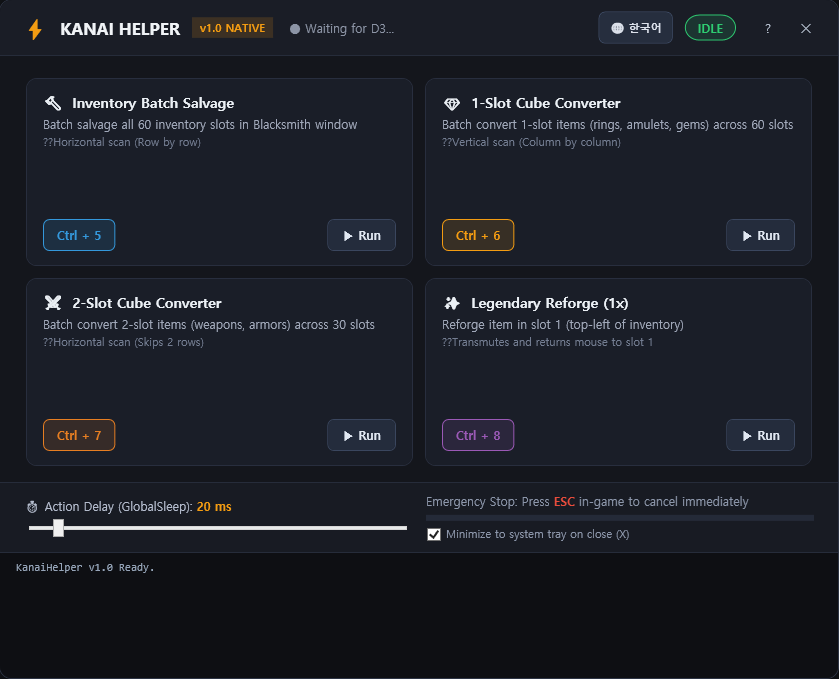
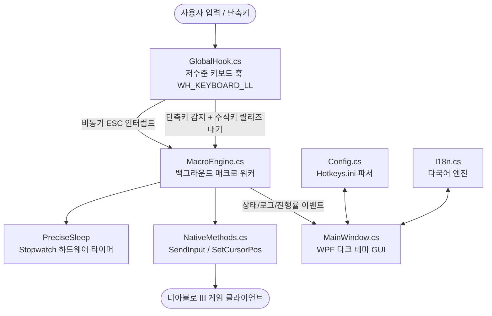

# ⚡ KanaiHelper v1.0 Native

<div align="center">

### 🎮 [👉 최신 버전 원클릭 다운로드 (KanaiHelper_v1.0.0_Portable.zip)](https://github.com/keunseop/KanaiHelper/releases/latest/download/KanaiHelper_v1.0.0_Portable.zip) 📥

[-brightgreen?logo=virustotal&style=flat-square)](https://www.virustotal.com/gui/file/5b1b4fb4ae137d3ba8d67abdf478bac8275dc4964e48032c6b9d2e1917a68b70?nocache=1)
[](LICENSE)
[](https://github.com/keunseop/KanaiHelper)

> 💡 **별도의 설치나 소스코드 빌드가 전혀 필요 없습니다!**  
> 위 파란색 다운로드 링크를 눌러 압축 파일(`.zip`)을 받으신 후,  
> 압축을 풀고 **`KanaiHelper.exe`**를 실행하시면 즉시 사용하실 수 있습니다.  
> 🛡️ [**VirusTotal 60여 개 백신 무결점(0/62 Clean) 검사 결과 실시간 확인**](https://www.virustotal.com/gui/file/5b1b4fb4ae137d3ba8d67abdf478bac8275dc4964e48032c6b9d2e1917a68b70?nocache=1)

---

</div>

<div align="center">

### 🖥️ 프로그램 실행 화면 (Modern Dark UI Dashboard)



</div>

---

> **디아블로 III 카나이의 함 변환 및 대장장이 분해 자동화 도구**  
> AutoHotkey 의존성을 완전히 제거하고, 순수 C# (.NET Framework 4.0 / WPF) Windows 64-bit 네이티브로 전면 재설계된 초경량 고성능 유틸리티입니다.

---

## 📌 목차
1. [기본 단축키 안내](#1-기본-단축키-안내)
2. [필수 게임 내 설정](#2-필수-게임-내-설정)
3. [프로젝트 발전사](#3-프로젝트-발전사)
4. [핵심 기술 사양 및 아키텍처](#4-핵심-기술-사양-및-아키텍처)
5. [소스코드 모듈 구조 (`src/`)](#5-소스코드-모듈-구조)
6. [빌드 및 배포 방법](#6-빌드-및-배포-방법)
7. [배포 패키지 구성 정책](#7-배포-패키지-구성-정책)

---

## 1. 기본 단축키 안내

사용 빈도가 가장 높은 **아이템 일괄 분해**를 1번 슬롯(Ctrl + 5)에 배치하여 최고의 편의성을 제공합니다:

| 단축키 | 기능 | 설명 및 사전 준비 |
| :---: | :--- | :--- |
| **Ctrl + 5** | **🔨 인벤토리 일괄 분해** | 대장장이 창의 '분해' 아이콘을 클릭한 상태에서 누르면 인벤토리 60칸을 가로 순서로 전설 확인 승인(Enter)을 거치며 일괄 분해합니다. |
| **Ctrl + 6** | **💎 1칸 아이템 큐브 변환** | 카나이의 함을 열고 원하는 레시피 페이지(예: 3페이지)를 펼쳐놓은 상태에서 누르면 60칸 전체를 세로 우선으로 순회하며 변환합니다. (반지, 목걸이 등) |
| **Ctrl + 7** | **⚔️ 2칸 아이템 큐브 변환** | 카나이의 함을 열고 원하는 레시피 페이지를 펼친 뒤 누르면 가로 2행씩 건너뛰며 30칸을 변환합니다. (무기, 방어구 등) |
| **Ctrl + 8** | **✨ 전설 아이템 재련 1회** | 인벤토리 맨 왼쪽 위(첫 번째 칸) 아이템을 1회 재련한 뒤 마우스를 다시 1번 칸으로 원복합니다. (반복 입력 가능) |
| **ESC** | **🛑 긴급 즉시 중단** | 매크로 동작 중 언제든 누르면 0.001초 이내에 즉시 안전 중단됩니다. |

> ※ 단축키는 프로그램 화면 대시보드의 버튼을 클릭하여 원하는 키로 언제든지 자유롭게 변경할 수 있습니다.  
> ※ 단축키를 누른 뒤 키(Ctrl 등)에서 손을 떼는 순간 매크로가 안전하게 시작됩니다.

---

## 2. 필수 게임 내 설정

1. **디아블로 III 화면 모드**:
   - 게임 내 [설정] -> [화면]에서 반드시 **[창 모드]** 또는 **[전체 화면(창) / Borderless]**으로 설정해 주세요.
   - (전체 화면 전용 모드에서는 윈도우 OS의 마우스 가상 좌표 변환이 왜곡될 수 있습니다.)
2. **관리자 권한 실행** (게임 내에서 단축키가 반응하지 않을 때):
   - 배틀넷 런처나 디아블로 III가 '관리자 권한'으로 실행 중인 경우, Windows 보안 정책(UIPI)으로 인해 일반 권한 프로그램의 가상 입력이 차단됩니다.
   - 게임 내에서 단축키가 동작하지 않는다면 `KanaiHelper.exe`를 **[마우스 우클릭 -> 관리자 권한으로 실행]**해 주세요.

---

## 3. 프로젝트 발전사

### 1) AutoHotkey 레거시 시대 (`v1.0 ~ v1.6.4`)
* **원작**: DaLeberkasPepi가 제작한 AutoHotkey v1.1 기반의 `CubeConverter.ahk` 스크립트에서 출발.
* **주요 개선 이력**:
  * **v1.6.1**: ESC 비상 중단 시 `Reload`(프로세스 재실행)를 호출하던 방식을 제거하고 실행 중 루프만 안전 종료하도록 개선. 게임 중 프로세스가 수십 개 중복 실행되던 메모리 누수 및 입력 충돌 버그 해결.
  * **v1.6.2**: 분해 매크로 순회 방식을 기존 세로 우선에서 **가로 우선(Row-first)** 순회로 변경하여 디아블로 III 인벤토리 구조에 최적화.
  * **v1.6.3**: 2칸 아이템 변환 후 분해 시 2행씩 건너뛰던 행 인덱스 간섭 버그 수정 (항상 1칸 단위 순회 보장).
  * **v1.6.4**: 단축키 입력 시 수식키(Ctrl, Shift, Alt 등)를 떼는 순간 매크로가 시작되도록 릴리즈 감지 로직 구현. 매크로 완료/중단 후 눌린 채 남은 수식키 상태를 강제 해제하여 입력 씹힘 문제 해결.

### 2) Windows Native 시대 (`v1.0 KanaiHelper`)
* **개발 배경**: AHK 인터프리터 설치 부담 해소, Windows 타이머 분해능(15.6ms 지터) 한계 극복, 모던 게이밍 GUI 및 안정적인 다국어 지원을 위해 전면 재개발.
* **주요 혁신점**:
  * **초경량 무설치 단일 실행 파일**: 외부 런타임 설치 불필요 (Windows 10/11 기본 내장 .NET 4.0 사용).
  * **하드웨어 타이머(QPC) 기반 초정밀 딜레이**: CPU 고빈도 카운터와 `timeBeginPeriod(1)`을 결합하여 어떤 PC에서도 20ms 등 지정된 주기를 100% 일정하게 유지.
  * **WPF 커스텀 다크 테마 대시보드**: 무프레임(Borderless) 윈도우, 라운드 코너, 시스템 트레이 상주, 실시간 활동 콘솔, 단축키 클릭 녹화 기능 탑재.
  * **마우스 오버 시인성 극대화**: WPF 기본 버튼의 흰색 하이라이트 오버레이를 제거하고, 에메랄드 그린/앰버 골드/보색 반전 다크 차콜 텍스트(`CreateButtonTemplate`)를 적용.
  * **한국어 / English 런타임 즉시 전환 (i18n)**: 원클릭 언어 토글 및 `Hotkeys.ini` 영속 저장.

---

## 4. 핵심 기술 사양 및 아키텍처



1. **고정밀 하드웨어 타이머 (QPC Hybrid Precision Sleep)**:
   - 일반 Windows의 `Thread.Sleep()`은 기본 분해능이 약 15.6ms로 심한 지터(Jitter)가 발생합니다.
   - `KanaiHelper`는 `timeBeginPeriod(1)`로 OS 타이머 분해능을 1ms로 끌어올린 후, `System.Diagnostics.Stopwatch`(QueryPerformanceCounter)를 사용하여 지정된 밀리초를 마이크로초 단위 오차로 정밀 제어합니다.
2. **0.001초 비동기 ESC 즉시 중단 (Zero-Latency Abort)**:
   - 매크로가 실행 중일 때 `WH_KEYBOARD_LL` 훅에서 ESC 입력을 감지하면 원자적 플래그(`_isCancelling = true`)를 세팅하여 즉시 루프를 탈출하고 수식키를 초기화합니다.
3. **수식키 릴리즈 안전장치 (Modifier Key Safety)**:
   - `Ctrl+5` 입력 시 사용자가 키보드에서 물리적으로 Ctrl 키를 뗄 때까지 대기한 후 마우스 클릭을 시작하여, 게임 내에서 'Ctrl + 우클릭'(아이템 링크 등)으로 오작동하는 현상을 원천 방지합니다.

---

## 5. 소스코드 모듈 구조

모든 핵심 소스코드는 `src/` 디렉터리에 위치하며, 외부 라이브러리(NuGet) 의존성이 전혀 없는 순수 C#입니다:

| 파일명 | 역할 및 핵심 기능 |
| :--- | :--- |
| `src/Program.cs` | 애플리케이션 진입점(`Main`). 시스템 전역 `Mutex` 기반 단일 인스턴스 보장, WPF App 구동 |
| `src/MainWindow.cs` | WPF 다크 테마 GUI 대시보드, 커스텀 `ControlTemplate`, 단축키 레코딩, 시스템 트레이 연동 |
| `src/MacroEngine.cs` | QPC 정밀 타이머, 해상도 비례 좌표 계산, 4종 매크로(분해/1칸/2칸/재련) 루프 실행 |
| `src/GlobalHook.cs` | Win32 `WH_KEYBOARD_LL` 저수준 키보드 훅, 비동기 ESC 감지, 키 녹화 캡처 |
| `src/Config.cs` | `Hotkeys.ini` 파일 입출력 파서, 단축키 모델(`HotkeyBinding`), 언어 및 딜레이 설정 |
| `src/I18n.cs` | 한국어(KO) 및 영어(EN) 다국어 리소스 딕셔너리 및 런타임 언어 전환 관리 |
| `src/NativeMethods.cs` | `SendInput`, `SetCursorPos`, `GetClientRect`, `FindWindow`, `timeBeginPeriod` 등 Win32 P/Invoke |

---

## 6. 빌드 및 배포 방법

### 1) 빌드 요구사항
- **운영체제**: Windows 7 이상 (Windows 10 / 11 완벽 지원)
- **컴파일러**: Windows 기본 내장 Microsoft .NET Framework 4.0 C# 컴파일러 (`csc.exe`)
- **특징**: Visual Studio나 별도 SDK 설치 없이 Windows 기본 환경에서 즉시 컴파일 가능!

### 2) 빠른 컴파일 (Build)
```powershell
.\build.bat
```
- 프로젝트 루트에 `KanaiHelper.exe` 단일 실행 파일이 생성됩니다.

### 3) 배포 패키징 (Packaging)
```powershell
python .\package.py
```
- 컴파일 수행 -> 배포 폴더 구성 -> 가이드 텍스트 자동 생성 -> `release/KanaiHelper_v1.0.0_Portable.zip` 무설치 포터블 압축 패키지가 자동 빌드됩니다.

---

## 7. 배포 패키지 구성 정책

일반 사용자가 다운로드하는 릴리즈 압축 파일(`KanaiHelper_v1.0.0_Portable.zip`)에는 사용 편의성을 위해 **오직 5개의 필수 파일만 포함**합니다:

```
KanaiHelper_v1.0.0_Portable/
├── KanaiHelper.exe          # 메인 실행 파일 (무설치 포터블)
├── Hotkeys.ini              # 기본 환경설정 파일 (단축키, 언어, 딜레이)
├── README_KO.txt            # 한국어 간편 사용 설명서 (메모장으로 즉시 열람 가능)
├── README_EN.txt            # English User Guide
└── 바탕화면_바로가기_만들기.bat # 호라드림 큐브 아이콘 바탕화면 바로가기 생성기
```
