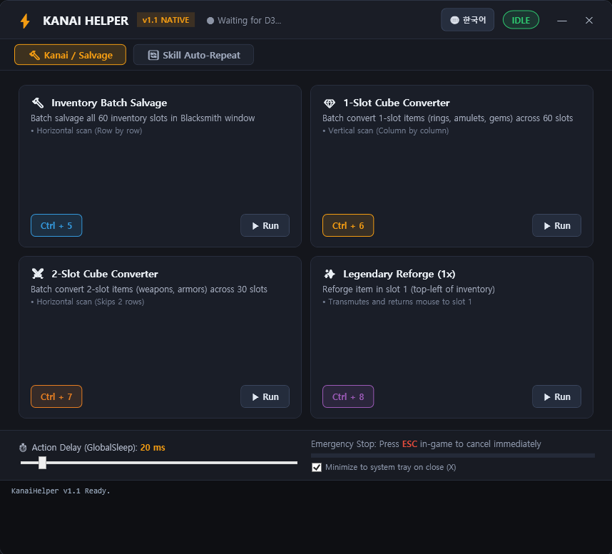
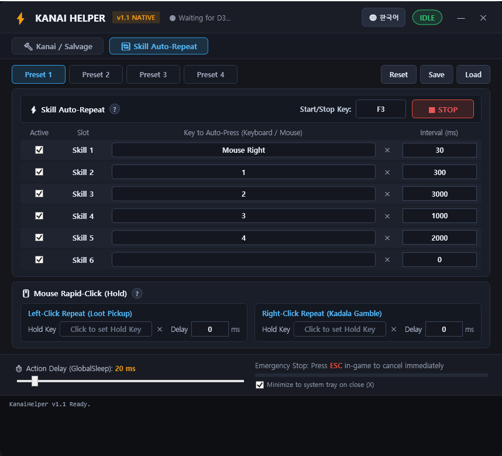
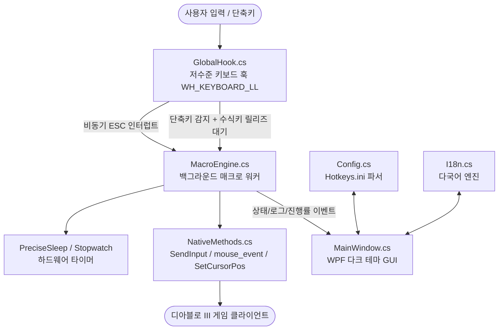

# ⚡ KanaiHelper v1.1 Native

<div align="center">

### 🎮 [👉 최신 버전 원클릭 다운로드 (KanaiHelper_v1.1.0_Portable.zip)](https://github.com/keunseop/KanaiHelper/releases/download/v1.1.0/KanaiHelper_v1.1.0_Portable.zip) 📥

[-brightgreen?logo=virustotal&style=flat-square)](https://www.virustotal.com/gui/file/7503ef0961cc02c13e33d0c93337eb69da3520ae4e783160d693c9167cac6880?nocache=1)
[](https://github.com/keunseop/KanaiHelper/releases/tag/v1.1.0)
[](LICENSE)
[](https://github.com/keunseop/KanaiHelper)

> 💡 **별도의 설치나 소스코드 빌드가 전혀 필요 없습니다!**  
> 위 다운로드 링크를 눌러 압축 파일(`.zip`)을 받으신 후,  
> 압축을 풀고 **`KanaiHelper.exe`**를 실행하시면 즉시 사용하실 수 있습니다.  
> 📦 [**v1.1.0 릴리즈 페이지 바로가기**](https://github.com/keunseop/KanaiHelper/releases/tag/v1.1.0) | 🛡️ [**VirusTotal 60여 개 백신 무결점(0/62 Clean) 검사 결과 실시간 확인**](https://www.virustotal.com/gui/file/7503ef0961cc02c13e33d0c93337eb69da3520ae4e783160d693c9167cac6880?nocache=1)  

---

</div>

<div align="center">

### 🖥️ 프로그램 실행 화면 (Modern Dark UI Dashboard)

#### 1) 🔨 카나이의 함 변환 & 인벤토리 일괄 분해 대시보드


<br>

#### 2) 🔄 스킬 자동 반복 & 마우스 홀드 연타 (D3 Helper 기능)


</div>

---

> **디아블로 III 종합 편의 유틸리티 (카나이의 함 변환 · 일괄 분해 · 스킬 반복키 · 마우스 연타)**  
> AutoHotkey 의존성을 완전히 제거하고, 순수 C# (.NET Framework 4.0 / WPF) Windows 64-bit 네이티브로 제작된 초경량 고성능 유틸리티입니다.

---

## 📌 목차
1. [기능 및 단축키 안내](#1-기능-및-단축키-안내)
2. [필수 게임 내 설정](#2-필수-게임-내-설정)
3. [프로젝트 발전사 및 릴리즈 노트](#3-프로젝트-발전사-및-릴리즈-노트)
4. [핵심 기술 사양 및 아키텍처](#4-핵심-기술-사양-및-아키텍처)
5. [소스코드 모듈 구조 (`src/`)](#5-소스코드-모듈-구조)
6. [빌드 및 배포 방법](#6-빌드-및-배포-방법)
7. [배포 패키지 구성 정책](#7-배포-패키지-구성-정책)

---

## 1. 기능 및 단축키 안내

KanaiHelper는 상단 탭을 통해 **[🔨 카나이 / 분해 매크로]**와 **[🔄 스킬 반복키 (D3 Helper)]** 기능을 자유롭게 전환할 수 있습니다.

### 1) 🔨 카나이 / 분해 매크로

| 단축키 | 기능 | 설명 및 사전 준비 |
| :---: | :--- | :--- |
| **Ctrl + 5** | **🔨 인벤토리 일괄 분해** | 대장장이 창의 '분해' 아이콘을 클릭한 상태에서 누르면 인벤토리 60칸을 가로 순서로 전설 확인 승인(Enter)을 거치며 일괄 분해합니다. |
| **Ctrl + 6** | **💎 1칸 아이템 큐브 변환** | 카나이의 함을 열고 원하는 레시피 페이지(예: 3페이지)를 펼쳐놓은 상태에서 누르면 60칸 전체를 세로 우선으로 순회하며 변환합니다. (반지, 목걸이 등) |
| **Ctrl + 7** | **⚔️ 2칸 아이템 큐브 변환** | 카나이의 함을 열고 원하는 레시피 페이지를 펼친 뒤 누르면 가로 2행씩 건너뛰며 30칸을 변환합니다. (무기, 방어구 등) |
| **Ctrl + 8** | **✨ 전설 아이템 재련 1회** | 인벤토리 맨 왼쪽 위(첫 번째 칸) 아이템을 1회 재련한 뒤 마우스를 다시 1번 칸으로 원복합니다. (반복 입력 가능) |
| **ESC** | **🛑 긴급 즉시 중단** | 매크로 동작 중 언제든 누르면 0.001초 이내에 즉시 안전 중단됩니다. |

> ※ 단축키는 프로그램 화면 대시보드의 버튼을 클릭하여 원하는 키로 언제든지 자유롭게 변경할 수 있습니다.  
> ※ 단축키를 누른 뒤 키(Ctrl 등)에서 손을 떼는 순간 매크로가 안전하게 시작됩니다.

### 2) 🔄 스킬 반복키 & 마우스 연타 (D3 Helper 기능)

* **⚡ 자동 스킬 반복 (토글 방식)**:
  * **시작/종료 기본키**: `F3` (다시 누르면 정지, 변경 가능)
  * 기술 1~6 슬롯에 원하는 키보드 키 또는 마우스 키(`Mouse Right`, `Mouse Left`, `Mouse Middle`)를 지정하고 반복 주기(`ms`)를 설정할 수 있습니다.
  * **세팅 1 ~ 세팅 4** 프리셋을 지원하여 캐릭터/빌드별 설정을 저장하고 즉시 전환할 수 있습니다.
  * 디아블로 3 창이 전면에 활성화되어 있을 때만 안전하게 입력됩니다.
* **🖱️ 마우스 연타 (누르는 동안만 작동)**:
  * **좌클릭 연타**: 아이템 줍기 등에 유용
  * **우클릭 연타**: 핏빛 파편 갬블 등에 유용
  * **홀드(Hold) 방식**: 지정한 단축키를 손가락으로 꾹 누르고 있는 동안에만 고속 연타되며, 손을 떼면 즉시 멈춥니다. F3 스킬 반복 상태와 관계없이 독립적으로 동작합니다.
* **설정 저장/불러오기**:
  * 반복키 탭에서 값을 수정한 뒤 **[저장하기]**를 눌러야 `Hotkeys.ini`에 영구 보존됩니다.
  * **[불러오기]**를 누르면 마지막으로 저장된 설정으로 언제든 복구할 수 있습니다.

---

## 2. 필수 게임 내 설정

1. **디아블로 III 화면 모드**:
   - 게임 내 [설정] -> [화면]에서 반드시 **[창 모드]** 또는 **[전체 화면(창) / Borderless]**으로 설정해 주세요.
   - (전체 화면 전용 모드에서는 윈도우 OS의 마우스 가상 좌표 변환이 왜곡될 수 있습니다.)
2. **관리자 권한 실행** (게임 내에서 단축키가 반응하지 않을 때):
   - 배틀넷 런처나 디아블로 III가 '관리자 권한'으로 실행 중인 경우, Windows 보안 정책(UIPI)으로 인해 일반 권한 프로그램의 가상 입력이 차단됩니다.
   - 게임 내에서 단축키가 동작하지 않는다면 `KanaiHelper.exe`를 **[마우스 우클릭 -> 관리자 권한으로 실행]**해 주세요.

---

## 3. 프로젝트 발전사 및 릴리즈 노트

### 1) v1.1.0 Native (New!)
* **스킬 반복키 (D3 Helper 기능) 전면 탑재**:
  * 상단 탭으로 카나이 매크로와 스킬 반복키 화면 분리
  * `F3` 시작/종료 토글 기반 6개 기술 슬롯 개별 주기(ms) 반복
  * 마우스 좌/우클릭 및 키보드 키 슬롯 지정 지원
  * 캐릭터/빌드별 **세팅 1 ~ 세팅 4** 프리셋 지원
  * 수동 [저장하기] / [불러오기] 방식 적용 (`Hotkeys.ini`)
* **독립 마우스 홀드 연타 (Hold-to-Repeat)**:
  * F3 토글과 별개로 지정 키를 꾹 누르고 있는 동안만 좌클릭(아이템 줍기)/우클릭(파편 갬블) 초고속 연타
* **UI/UX 개선 및 버그 수정**:
  * 윈도우 우상단 최소화 버튼(`─`) 및 인코딩 깨짐 복구
  * 섹션별 깔끔한 원형 `?` 도움말 레이어 팝업 추가

### 2) v1.0.0 Native
* AHK 의존성을 완전히 제거하고 순수 C# WPF 네이티브로 전면 재개발.
* CPU 하드웨어 타이머(QPC) 기반 초정밀 딜레이 제어 및 다크 테마 대시보드 구축.

### 3) AutoHotkey 레거시 시대 (`v1.0 ~ v1.6.4`)
* `CubeConverter.ahk` 스크립트 기반 개선 (가로 우선 순회, ESC 즉시 탈출, 수식키 릴리즈 보정 등).

---

## 4. 핵심 기술 사양 및 아키텍처



---

## 5. 소스코드 모듈 구조

모든 핵심 소스코드는 `src/` 디렉터리에 위치하며, 외부 라이브러리(NuGet) 의존성이 전혀 없는 순수 C#입니다:

| 파일명 | 역할 및 핵심 기능 |
| :--- | :--- |
| `src/Program.cs` | 애플리케이션 진입점(`Main`). 시스템 전역 `Mutex` 기반 단일 인스턴스 보장, 중복 실행 방지 |
| `src/MainWindow.cs` | WPF 다크 테마 대시보드, 탭 네비게이션, 프리셋 UI, 도움말 팝업, 단축키 레코딩, 트레이 연동 |
| `src/MacroEngine.cs` | QPC 정밀 타이머, 카나이 4종 매크로 루프, 스킬 반복 워커, 독립 마우스 홀드 연타 스레드 |
| `src/GlobalHook.cs` | Win32 `WH_KEYBOARD_LL` 저수준 키보드 훅, 비동기 ESC 감지, F3 토글, 단축키 캡처 |
| `src/Config.cs` | `Hotkeys.ini` 파일 입출력 파서, 세팅 1~4 프리셋 모델, 일반 설정 및 반복키 설정 분리 저장 |
| `src/I18n.cs` | 한국어(KO) 및 영어(EN) 다국어 리소스 딕셔너리, 도움말 텍스트, 런타임 언어 전환 관리 |
| `src/NativeMethods.cs` | Win32 P/Invoke API 모음 (`mouse_event`, `keybd_event`, `timeBeginPeriod` 등) |

---

## 6. 빌드 및 배포 방법

### 1) 빌드 요구사항
- **운영체제**: Windows 7 이상 (Windows 10 / 11 완벽 지원)
- **컴파일러**: Windows 기본 내장 Microsoft .NET Framework 4.0 C# 컴파일러 (`csc.exe`)
- **특징**: Visual Studio나 별도 SDK 설치 없이 Windows 기본 환경에서 즉시 컴파일 가능!

### 2) 빠른 컴파일 (Build)
```powershell
.\build.bat
```
- 프로젝트 루트에 `KanaiHelper.exe` 단일 실행 파일이 생성됩니다.

### 3) 배포 패키징 (Packaging)
```powershell
python .\package.py
```
- 컴파일 수행 -> 배포 폴더 구성 -> 가이드 텍스트 자동 생성 -> `release/KanaiHelper_v1.1.0_Portable.zip` 무설치 포터블 압축 패키지가 자동 빌드됩니다.

---

## 7. 배포 패키지 구성 정책

일반 사용자가 다운로드하는 릴리즈 압축 파일(`KanaiHelper_v1.1.0_Portable.zip`)에는 사용 편의성을 위해 **오직 5개의 필수 파일만 포함**합니다:

```
KanaiHelper_v1.1.0_Portable/
├── KanaiHelper.exe          # 메인 실행 파일 (무설치 포터블)
├── Hotkeys.ini              # 기본 환경설정 파일 (단축키, 언어, 프리셋)
├── README_KO.txt            # 한국어 간편 사용 설명서 (메모장으로 즉시 열람 가능)
├── README_EN.txt            # English User Guide
└── 바탕화면_바로가기_만들기.bat # 호라드림 큐브 아이콘 바탕화면 바로가기 생성기
```
